<!-- ===================================================== -->
<!-- THEEMCOOL // BLACKOUT TERMINAL x NEON MATRIX          -->
<!-- Palette: #030605 #080D0B #003B29 #00FF88 #00D9FF      -->
<!-- Assets: assets/                                       -->
<!-- ===================================================== -->


<br/>

<table>
<tr>
<td width="30%" valign="top">

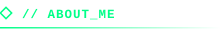

Software Engineering trainee at **Moringa School** and Computer Science undergraduate at **Cooperative University of Kenya (CUK)**.

I'm passionate about building practical software, exploring AI, and creating digital experiences that solve real problems.

🎓 **Moringa School**  
<sub>Software Engineering Trainee</sub>

🎓 **Cooperative University of Kenya**  
<sub>BSc Computer Science</sub>

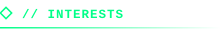

```text
> AI & Machine Learning
> Cloud Engineering
> Cybersecurity
> Web Development
> UI/UX Design
```

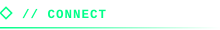

**GitHub** · [theemcool](https://github.com/theemcool)  
**Portfolio** · [Visit my website](https://theemcool.github.io/Portfolio/)  
**Email** · [nandwah7@gmail.com](mailto:nandwah7@gmail.com)  
**LinkedIn** · [Humphrey Nandwa](https://linkedin.com/in/humphrey-nandwa-966670439)

`> Always learning...`

</td>
<td width="70%" valign="top">


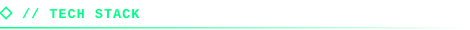

**Languages & Databases**


**Web Development**


**Tools & Technologies**


</td>
</tr>
</table>

<br/>

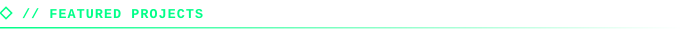

<table>
<tr>
<td width="50%" valign="top">

### ◈ [ElimuAI](https://github.com/theemcool?tab=repositories)

An AI-powered EdTech concept focused on making learning support more accessible and affordable for students in Kenya and across Africa.

`AI` `EdTech` `Education`

</td>
<td width="50%" valign="top">

### ◈ [Wordly](https://github.com/hum2006/wordly)

A dictionary application designed to support vocabulary development and make discovering word meanings easier.

`Application` `Learning`

</td>
</tr>
<tr>
<td width="50%" valign="top">

### ◈ [E-Commerce Admin Portal](https://github.com/darktotem/e-commerce-administrator-portal)

A React-based dashboard project focused on managing e-commerce operations through an administrative interface.

`React` `JavaScript` `Dashboard`

</td>
<td width="50%" valign="top">

### ◈ [Inventory Management System](https://github.com/theemcool?tab=repositories)

A Python and Flask REST API for managing inventory, with JSON-based storage and automated tests.

`Python` `Flask` `REST API`

</td>
</tr>
<tr>
<td width="50%" valign="top">

### ◈ Airline Management System

A C# project focused on passenger workflows and database integration.

`C#` `Database`

</td>
<td width="50%" valign="top">

### ◈ [Personal Portfolio](https://theemcool.github.io/Portfolio/)

My personal website showcasing my work, technical skills, and development journey.

`Frontend` `Web Design`

</td>
</tr>
</table>

<br/>

<table>
<tr>
<td width="50%" valign="top">

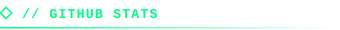


</td>
<td width="50%" valign="top">

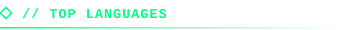


</td>
</tr>
</table>

<br/>

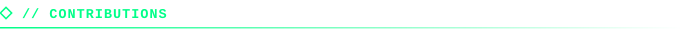

<div align="center">


<!-- Requires the Platane/snk GitHub Action to generate the output branch. -->


</div>

<br/>

<table>
<tr>
<td width="58%" valign="top">

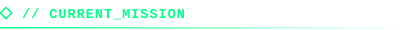

- [x] Strengthen software engineering skills
- [x] Build practical projects
- [x] Learn about AI systems and evaluation
- [x] Improve frontend and backend development
- [x] Explore cloud engineering and cybersecurity

**STATUS:** `Always learning...`

</td>
<td width="42%" valign="top">

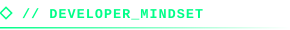

```text
01. Stay curious.
02. Start building.
03. Learn from mistakes.
04. Make it better.
05. Repeat.
```

**Progress over perfection.**

</td>
</tr>
</table>

<br/>

<div align="center">


</div>
